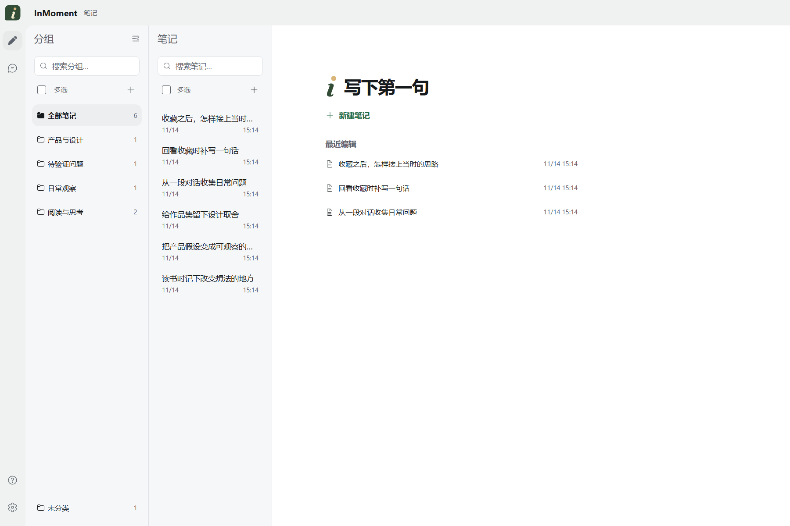
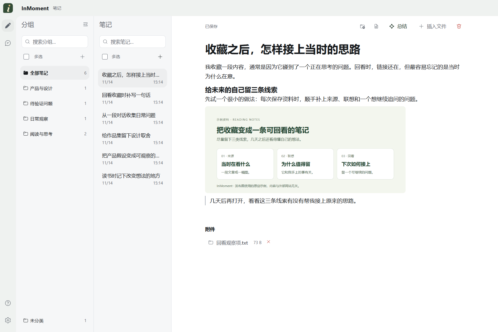
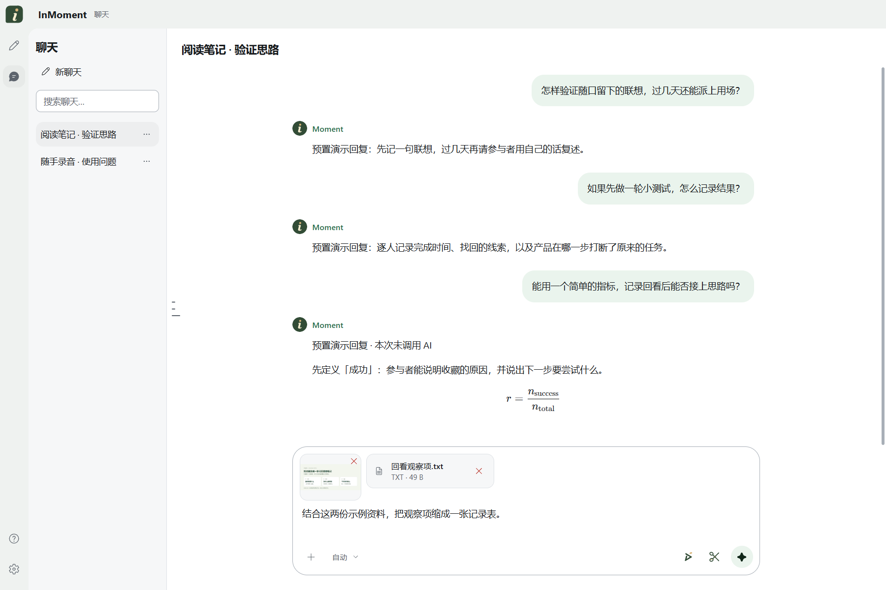
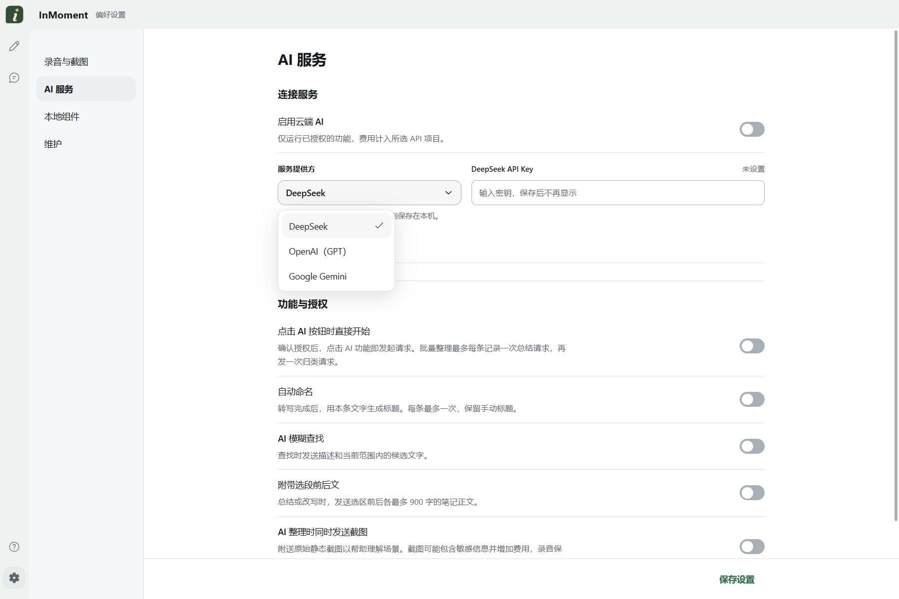

# InMoment

**Capture a thought in context. Turn it into a note, discuss it with AI, or share it with its sources.**

[简体中文](README.md) · [User guide, Chinese](docs/USER_GUIDE.md) · [0.14.31 release notes, Chinese](docs/releases/0.14.31.md) · [Changelog](CHANGELOG.md) · [Product decisions](docs/product/PRODUCT_STORY.md)

[](https://github.com/lenqi777/InMoment/releases/download/v0.14.31-installer/InMoment-Setup-0.14.31-x64.exe)

[Release notes](https://github.com/lenqi777/InMoment/releases/tag/v0.14.31-installer) · [SHA-256 checksums](https://github.com/lenqi777/InMoment/releases/download/v0.14.31-installer/SHA256SUMS.txt)

InMoment is a local-first Windows desktop app that brings recordings, screenshots, and source context into editable notes. Write a note directly or speak a thought while reading or working. Search, group, and export your notes, or bring notes and files into a chat and save useful exchanges back to the library.



*Screenshots show the actual 0.14.31 interface with isolated synthetic data and prepared AI examples. See the [asset provenance](docs/assets/releases/v0.14.31/PROVENANCE.json).*

## Capture and organize

- **Speak the thought.** The first right-button hold starts recording; release to pause. Click Continue to record hands-free, then Pause. All segments stay in one draft. Choose whether to retain text, audio, or both when saving.
- **Capture a region and speak.** Press `Ctrl+Shift+F9` and drag a selection. Release to start recording; annotate the screenshot and confirm it to add it to the draft. Open a note's background details to revisit retained audio, screenshots, and source information.
- **Work in one library.** Handwritten notes save automatically. Recording and chat notes appear in the same library. Organize notes into groups, add links and files, or export notes as PDF or Markdown with their supporting attachments.
- **Extract text from images.** Recognize text from a whole image or a selected region in note and chat image previews. OCR runs locally; copy the result or insert it into the note when working in the editor.



## Discuss your sources

Reference a note or attach PDFs, UTF-8 text, MP4 clips, and images in one message. Math renders locally. The side navigation jumps between questions and follows the current reading position. Main-window chats save automatically, and a whole conversation or selected messages can be saved as a note.



Choose DeepSeek, OpenAI (GPT), or Google Gemini for cloud AI. Let InMoment choose the answer model, or select a model and reasoning level yourself. Full-note summaries save as separate attachments; preview changes before applying a rewrite to selected text.

## Download and run

**0.14.31 · Windows 11 x64**: [Download the Windows installer (EXE)](https://github.com/lenqi777/InMoment/releases/download/v0.14.31-installer/InMoment-Setup-0.14.31-x64.exe). The interface is in Chinese.

Older downloads: [0.10.0 full package](https://github.com/lenqi777/InMoment/releases/tag/v0.10.0) · [0.1.0–0.9.0 archives](https://github.com/lenqi777/InMoment/releases/tag/history-binaries) · [All releases](https://github.com/lenqi777/InMoment/releases).

1. Open `InMoment-Setup-0.14.31-x64.exe` and choose the installation folder.
2. If the VC++ x64 Runtime is missing, setup asks before downloading it from Microsoft. When setup finishes, open InMoment from the Start menu.
3. Grant microphone permission to record, or create a note directly. The full package includes offline transcription, a local semantic model, and image OCR. Everyday local features require no API key or separate Node.js, pnpm, or Python installation.
4. For cloud AI, open Settings → AI Services, enter a key for your chosen provider, and enable the permissions you need. Capabilities, quotas, and charges depend on your service account. See [AI service setup](docs/AI_PROVIDER_SETUP.md).



| Task | Where it runs and what it needs |
| --- | --- |
| Notes, recording, playback, transcription, keyword search, image OCR, PDF or Markdown export | On your device; recording and screenshots require applicable system permissions |
| Chat, summaries, rewrites and AI grouping suggestions | Network access, an API key for the selected provider, and your consent |
| PDF, text, video and image attachments in chat | Provider support is required. Gemini can receive original PDFs and MP4s, and GPT can receive original PDFs. DeepSeek receives locally extracted PDF text and sampled page images |
| MP4 analysis with GPT or DeepSeek | Local frame sampling and transcription require external `ffmpeg.exe` and `ffprobe.exe`. Put them in `chat-media/bin/` next to the app, or on PATH. Gemini's original-video route does not need them |

GitHub's automatic **Source code** archives are for development. See [release readiness](docs/releases/READINESS.md) for verification results and runtime requirements.

## Your data, upgrades and versions

Notes, audio, screenshots and attachments are stored in the current Windows user's application-data directory. Cloud AI starts disabled, and sending screenshots with AI organization requires separate consent. Note AI features do not upload original recordings. Chat attachments you send are handled by the chosen provider. API keys use Windows DPAPI protection; the library and media are not encrypted as a whole. See the [data policy](PRIVACY.md) and [security notes](SECURITY.md).

To upgrade, quit from the tray and back up `%APPDATA%\InMoment`, then run the installer for the new version. Use a separate data directory when evaluating an older version. See the [version inventory](docs/releases/VERSIONS.md). The [0.14.16 notes](docs/releases/0.14.16.md), [original animation](docs/assets/workflow.gif), and [silent demo](docs/assets/inmoment-demo-silent.mp4) remain available as historical material.

## Development and validation

InMoment began with the author's own note-taking workflow. The [product decisions](docs/product/PRODUCT_STORY.md) document requirements, interaction design, AI workflows, and validation. Automated checks use synthetic data and mocked responses; see the [validation log](docs/validation.md). Installation on a clean Windows system, live transcription quality, and cloud behavior still require testing in their respective environments.

Development requires Windows 11 x64, Node.js 24+, and pnpm 11.25.0:

```powershell
pnpm install --frozen-lockfile
pnpm native:build
pnpm check
pnpm test
pnpm start
```

See the [development guide](docs/DEVELOPMENT.md) for model preparation, isolated checks, and packaging. The source is [MIT licensed](LICENSE); bundled components retain their [own licenses](THIRD_PARTY_NOTICES.md).
