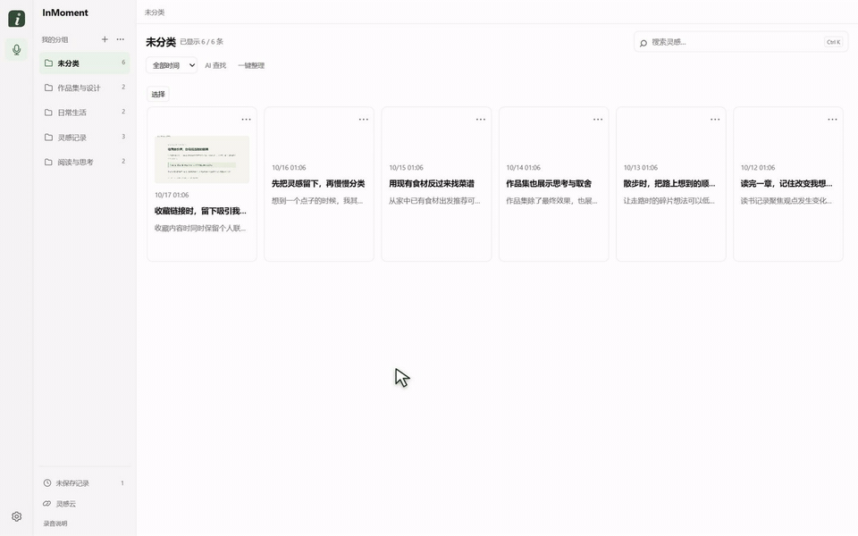

# InMoment

**Say the thought while it is fresh. Keep the context that inspired it.**

[简体中文](README.md) · [User guide, Chinese](docs/USER_GUIDE.md) · [Changelog](CHANGELOG.md) · [Product decisions](docs/product/PRODUCT_STORY.md)

InMoment is a local-first Windows desktop app for capturing ideas while reading, browsing or exploring designs. Hold the right mouse button to record a thought alongside its source context. Return later to listen, review the screenshot, organize records, or search by what you remember.


*The interface uses synthetic example records and prepared summaries and groups. Demonstrations show the workflow, not measured AI quality.*

## Capture, review, find

- **Capture first.** The initial right-button hold records; releasing pauses. Clicking Continue then records hands-free until Pause is clicked. Every segment belongs to one draft, which you can complete or discard.
- **Keep the context.** Review the original audio, transcript, source-window information and a single-window screenshot. Capture failures remain visible.
- **Organize later.** Rename and group records yourself, or request an AI summary. Batch organization compares the currently displayed records and previews shared grouping suggestions for your approval.
- **Find a half-remembered idea.** Use local keyword search, AI-assisted search with local candidates and cloud ranking, or the local idea cloud to browse related records.
- **Continue a thought.** Create a linked new record while keeping each recording and its context separate.



[Watch the silent demo](docs/assets/inmoment-demo-silent.mp4) · [Read the user guide](docs/USER_GUIDE.md)

## Download and run

The current app version is **0.10.0**, targeting **Windows 11 x64**. Choose the full portable package from the [0.10.0 Release](https://github.com/lenqi777/InMoment/releases/tag/v0.10.0). A formal installer is not currently provided. The app interface and default speech transcription are currently Chinese.

1. Download `InMoment-0.10.0-win-x64-full.zip` and extract the entire archive to a local folder.
2. Run `Install-InMoment.cmd` once. If the system runtime is missing, setup asks before downloading the official Microsoft installer and opens its original license/setup UI. Then run `InMoment.exe`. Keep its accompanying runtime and model folders together.
3. Allow microphone access when prompted. Hold the right mouse button to record, release to pause, then complete the record.
4. For cloud AI features, enter **your own DeepSeek API key** in Settings and enable the relevant permissions. Sending screenshots requires separate consent. API charges belong to your service account.

The full package includes the app runtime, offline speech recognizer and local semantic model. End users do not need Node.js, pnpm or a separate model download. GitHub's automatically generated **Source code** archives are for development; see the [development guide](docs/DEVELOPMENT.md).

The current full package and checksums are listed in the [0.10.0 Release](https://github.com/lenqi777/InMoment/releases/tag/v0.10.0), and 11 historical packages are listed in the [historical binary archive](https://github.com/lenqi777/InMoment/releases/tag/history-binaries). Consult each Release for its assets, hashes and validation status. Clean-machine Windows acceptance and live cloud end-to-end validation remain pending, so compatibility across devices and service accounts has not yet been established.

The release preparation updates the image dependency to address high-severity advisories. One moderate transitive advisory has no upstream fix yet; its restricted installation-tool path and remaining limits are recorded in the [dependency review](docs/releases/DEPENDENCY_REVIEW.md).

## Local and cloud features

| Feature | Where it runs | What you supply |
| --- | --- | --- |
| Recording, playback, screenshots, editing and manual groups | On your device | Microphone and operating-system permissions |
| Chinese speech transcription | Local whisper.cpp / Whisper base | Included in the full package |
| Keyword search, semantic candidates and idea cloud | On your device; E5 for semantic features | Models included in the full package |
| AI summaries, batch grouping, AI search and optional automatic titles | DeepSeek cloud | Your API key, network access and feature consent |

Cloud features start disabled. Local recording, library management, transcription, keyword search and the idea cloud remain available without cloud AI. AI search's cloud ranking requires its permission. Transcription and semantic quality depend on the content and device.

## Your data

Records, audio, screenshots and indexes stay in the current Windows user's application-data directory. Drafts remain local and provisional until completed. Discard revokes pending writes and clears the draft's files.

Authorized cloud features send selected text and source context; screenshots need separate consent. These features do not upload original audio. API keys use Windows DPAPI protection; the record database and media are not fully encrypted. Read the [data policy](PRIVACY.md) and [security notes](SECURITY.md).

## Versions and validation

Start with the current version. The [version inventory](docs/releases/VERSIONS.md) documents packages in the [historical binary archive](https://github.com/lenqi777/InMoment/releases/tag/history-binaries) and their limits. Back up your data before using an older version, and avoid concurrent writes from different versions to the same data directory.

This personal product project began with the author's own note-taking workflow. The author owns requirements, interaction design, AI workflow decisions and acceptance, with implementation and automated tests assisted by AI coding tools. [Product decisions and evidence boundaries](docs/product/PRODUCT_STORY.md) explain the tradeoffs.

Automated tests use mocked model responses and synthetic data to check saving, cancellation, permissions, request scope and result application. See the [validation log](docs/validation.md). Real Chinese transcription, summary quality, grouping quality, retrieval recall and time savings still require systematic evaluation. No external user-growth or productivity results are claimed.

Development requires Windows 11 x64, Node.js 24+ and pnpm 11.25.0:

```powershell
pnpm install --frozen-lockfile
pnpm native:build
pnpm check
pnpm test
pnpm start
```

See the [development guide](docs/DEVELOPMENT.md) for model preparation, isolated testing and packaging. Follow [AGENTS.md](AGENTS.md); live model or API calls during development require explicit approval.

Source code is [MIT licensed](LICENSE). Bundled components retain their [own licenses and notices](THIRD_PARTY_NOTICES.md).
