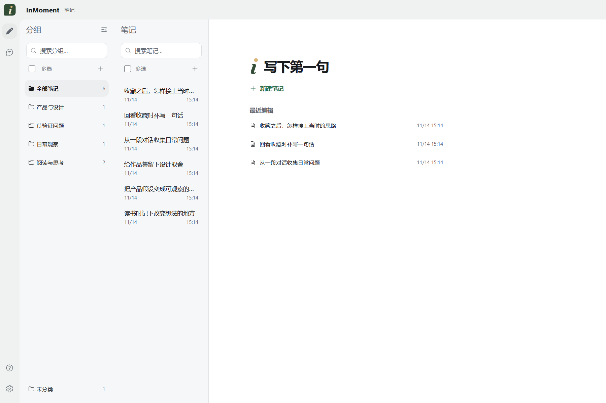
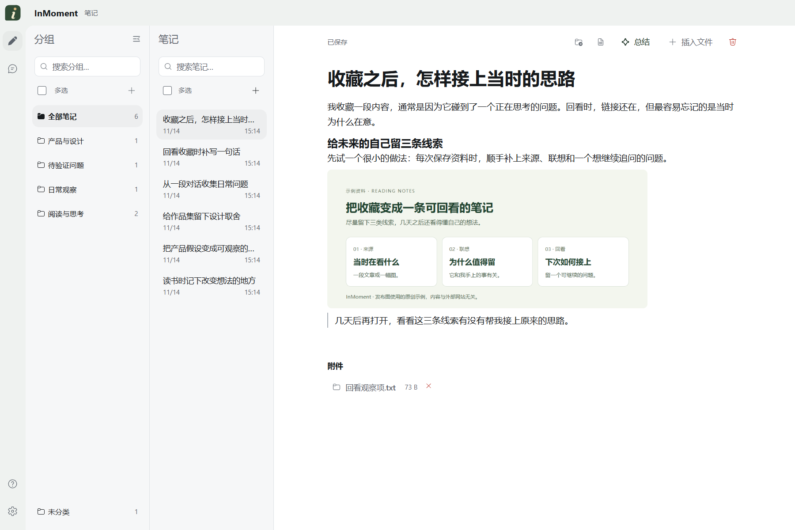
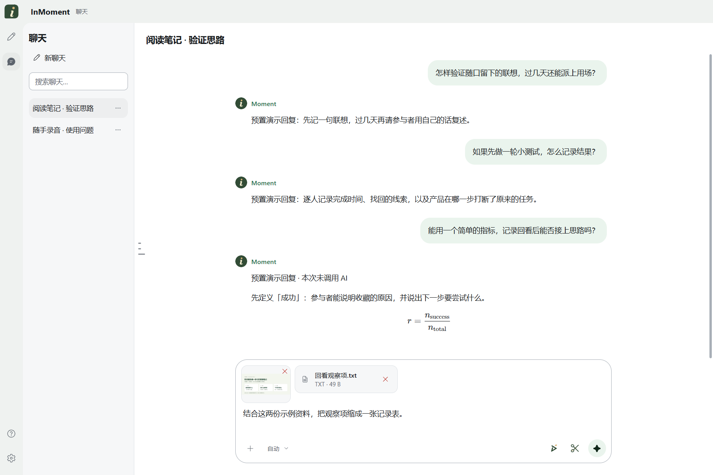
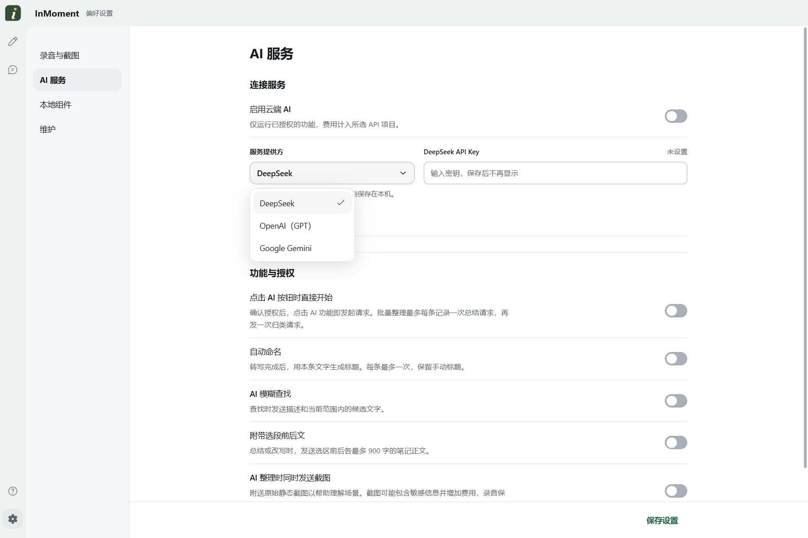

# InMoment · 灵感现场

**先把想法留下，再写成笔记、带进聊天，或和资料一起归档。**

[English](README.en.md) · [使用指南](docs/USER_GUIDE.md) · [0.14.31 更新说明](docs/releases/0.14.31.md) · [完整更新记录](CHANGELOG.md) · [产品设计](docs/product/PRODUCT_STORY.md)

[](https://github.com/lenqi777/InMoment/releases/download/v0.14.31-installer/InMoment-Setup-0.14.31-x64.exe)

[发布说明](https://github.com/lenqi777/InMoment/releases/tag/v0.14.31-installer) · [SHA-256 校验文件](https://github.com/lenqi777/InMoment/releases/download/v0.14.31-installer/SHA256SUMS.txt)

InMoment 是一个本地优先的 Windows 桌面工具，把当下的录音、截图和来源整理到可编辑的笔记中。你可以随手写一条，也可以在阅读或工作时说下来，再搜索、分组或导出。想继续讨论时，将笔记、图片和文件带进聊天，最后把有用的回答存回笔记。



*本页截图取自 0.14.31 实际界面，使用隔离的合成示例内容；AI 展示内容为预置结果。[截图来源](docs/assets/releases/v0.14.31/PROVENANCE.json)*

## 从灵感到笔记

- **说下来。** 首次长按右键录音，松开暂停。点击继续后可以免按住说，再点击暂停停下。所有片段属于同一草稿，保存时可选择保留文字、录音或两者。
- **圈出现场再说。** 按 `Ctrl+Shift+F9` 后框选，松手开始录音。可以继续标注，确认后把选区图片存入当前草稿。打开笔记的「背景信息」，就能查看保留的录音、截图与来源。
- **整理为可分享的笔记。** 手写笔记自动保存，录音笔记和聊天笔记也在同一个列表。支持分组、图片、链接及文件，可导出为 PDF 或 Markdown，并另存相关附件。
- **提取图片里的文字。** 在笔记或聊天图片中按需提取全图或指定区域的文字。识别在本机运行，结果可复制；在笔记中也可直接插入正文。



## 带着资料继续讨论

在聊天中引用笔记，或一同添加 PDF、UTF-8 文本、MP4 和图片。公式在本地排版，侧边短线按提问跳转，滚动时跟随当前阅读轮次。主窗口聊天会自动保存，可以把整段聊天或选中的对话存为笔记。



云端服务可选 DeepSeek、OpenAI（GPT）或 Google Gemini。聊天可以指定回答模型和推理强度，也可以让应用自动选。笔记的全文总结单独保存为附件；选段改写先给出衔接预览，接受后写回正文。

## 下载与开始使用

**0.14.31 · Windows 11 x64**：[下载 Windows 安装包（EXE）](https://github.com/lenqi777/InMoment/releases/download/v0.14.31-installer/InMoment-Setup-0.14.31-x64.exe)。

旧版下载：[0.10.0 完整包](https://github.com/lenqi777/InMoment/releases/tag/v0.10.0) · [0.1.0–0.9.0 历史版本](https://github.com/lenqi777/InMoment/releases/tag/history-binaries) · [全部发布版本](https://github.com/lenqi777/InMoment/releases)。

1. 双击 `InMoment-Setup-0.14.31-x64.exe`，按向导选择安装目录。
2. 若缺少 VC++ x64 Runtime，向导会在征得同意后从微软下载。完成后从开始菜单打开 InMoment。
3. 允许麦克风访问后即可录音，也可以直接新建笔记。完整包内置离线语音转写、本地语义模型和图片 OCR，日常本地功能无需 API Key 或另装 Node.js、pnpm、Python。
4. 需要云端 AI 时，打开「偏好设置 → AI 服务」，填写所选服务的 API Key 并授权。实际能力、额度和费用由你的服务账户决定。配置方式见 [AI 服务设置](docs/AI_PROVIDER_SETUP.md)。



| 场景 | 运行位置和条件 |
| --- | --- |
| 写笔记、录音、回听、转写、关键词搜索、图片 OCR、PDF／Markdown 导出 | 本机；使用录音或截图时需要相应系统权限 |
| 聊天、笔记总结与改写、AI 分组建议 | 联网，使用所选服务的 API Key 与功能授权 |
| 在聊天中分析 PDF、文本、视频和图片 | 需所选服务支持；Gemini 可接收原始 PDF、MP4，GPT 可接收原始 PDF，DeepSeek 在本机提取 PDF 文字和抽样页图 |
| 通过 GPT 或 DeepSeek 分析 MP4 | 本机先抽帧及转写；需额外提供 `ffmpeg.exe` 和 `ffprobe.exe`，放在程序旁的 `chat-media/bin/` 或加入 PATH。Gemini 原视频路径无需此工具 |

GitHub 自动生成的 **Source code** 压缩包供开发使用。[发布状态](docs/releases/READINESS.md)记录了本版的验证范围和运行条件。

## 资料、升级与版本

资料、录音、截图和附件保存在当前 Windows 用户的应用数据目录。云端功能默认关闭，截图随 AI 整理发送需要单独授权。原始录音不随笔记 AI 功能上传；主动发送的聊天附件按所选厂商处理。API Key 由 Windows DPAPI 保护，资料库及媒体未整体加密。见[数据说明](PRIVACY.md)与[安全说明](SECURITY.md)。

升级前从托盘退出程序并备份 `%APPDATA%\InMoment`，再运行新版安装向导。试用旧版时使用独立资料目录。各版本及附件见[版本清单](docs/releases/VERSIONS.md)，[0.14.16 更新说明](docs/releases/0.14.16.md)、[原版操作动图](docs/assets/workflow.gif)与[无音轨演示](docs/assets/inmoment-demo-silent.mp4)作为历史材料保留。

## 开发与验证

InMoment 源于作者自己的记录习惯。产品需求、交互设计、AI 工作流和验证思路记录在[产品设计](docs/product/PRODUCT_STORY.md)。自动化检查使用合成资料与模拟回复，验证结果见[验证记录](docs/validation.md)。全新 Windows 安装、真实语音识别与云端效果仍待对应环境验收。

开发环境为 Windows 11 x64、Node.js 24+、pnpm 11.25.0：

```powershell
pnpm install --frozen-lockfile
pnpm native:build
pnpm check
pnpm test
pnpm start
```

模型准备、隔离测试和打包见[开发指南](docs/DEVELOPMENT.md)。源码采用 [MIT 许可证](LICENSE)，随附组件保留各自的[第三方许可](THIRD_PARTY_NOTICES.md)。
