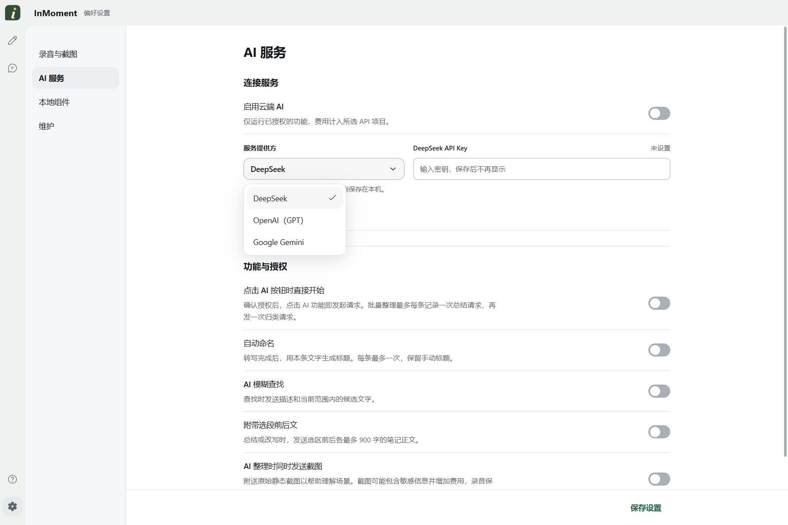

# AI 服务设置

适用于 **InMoment 0.14.31**。应用支持 DeepSeek、OpenAI（GPT）和 Google Gemini。三个服务分别保存 API Key，聊天、笔记总结与改写、分组建议和自动命名使用当前已保存的服务。默认自动选择模型。

## 设置步骤

1. 打开「偏好设置 → AI 服务」。
2. 在“AI 服务”中选择一个服务。
3. 保持自动选择模型；如需自定义，可展开“高级：手动指定模型”并启用手动指定。
4. 在当前服务的 API Key 输入框中填入自己的密钥。已有密钥时留空表示保留。
5. 开启“云端 AI”和需要使用的功能，点击“保存设置”，按提示确认发送范围和授权。

下拉选项和输入内容先保存在当前表单中，点击“保存设置”后才用于任务。可以在保存前切换服务，分别填写配置。保存只检查配置格式，不发起 API 测试；实际请求在主动使用相应功能或已授权的自动命名时发生。

## 获取 API Key

| 服务 | 获取位置 | 本应用的接入方式 |
| --- | --- | --- |
| DeepSeek | [DeepSeek API 官方文档](https://api-docs.deepseek.com/api/deepseek-api/)中的“创建 API Key”入口 | 使用你在 DeepSeek 开放平台创建的密钥 |
| OpenAI（GPT） | [OpenAI 官方快速开始](https://developers.openai.com/api/docs/quickstart)中的“Create API Key”入口 | 使用 OpenAI API 项目密钥 |
| Google Gemini | [Google 官方 API Key 说明](https://ai.google.dev/gemini-api/docs/api-key)与 Google AI Studio 的 API Keys 页面 | 使用 Gemini API 密钥 |

InMoment 使用 API Key 接入。OpenAI 选项不使用 ChatGPT 账号登录；Gemini 选项不使用 Gemini 网页账号或会员登录授权。API 可用模型、额度和费用查看所选服务的控制台。

密钥由当前 Windows 用户的系统保护机制加密保存，保存后不再显示。三个服务的密钥相互独立；所选服务未配置密钥时会提示补充，不会借用另一个服务的密钥。

## 模型预设和自定义名称

当前内置预设如下，账户是否有权使用以所选服务的控制台和实际请求结果为准。

| 服务 | 默认模型 | 其他预设 |
| --- | --- | --- |
| DeepSeek | `deepseek-flash` | `deepseek-v4-pro` |
| OpenAI（GPT） | `gpt-5.4-mini` | `gpt-6-astra`、`gpt-6.1-sol`、`gpt-6.1-terra`、`gpt-6-sol`、`gpt-6-luna`、`gpt-5.6-sol`、`gpt-5.6-terra`、`gpt-5.6-luna`、`gpt-5.5`、`gpt-5.4`、`gpt-5.2` |
| Google Gemini | `gemini-3.8-flash` | `gemini-3.1-flash-lite`、`gemini-4-argon` |

聊天的自动模式会根据问题选择模型。简单问题用轻量模型，明确要求深入推理或核对多份材料时提高推理强度，并按服务与附件能力选择模型。Gemini 的“优先使用免费模型”默认开启，自动选择与附件协作优先使用有免费层的型号。项目额度与实际计费取决于 Google 账户配置，手动选定的回答模型仍按你的选择执行。

模型输入框也接受其他名称。只填写模型标识，不带网址或 `models/` 前缀；名称为 1–100 个字符，以英文字母或数字开头，可使用点、下划线、冒号和连字符。模型需要在你的 API 账户中可用，并支持对应接口的 JSON 输出。

当前图片支持判断覆盖 DeepSeek Flash、GPT-4o／4.1／5／6 系列，以及 Gemini 2.5 和 3 及以上的通用模型；音频、TTS 和 Live 等专用 Gemini 模型不在截图支持范围内。具体判断由当前版本的服务配置决定。自定义模型若未被识别为支持图片，程序会提示，不会悄悄去掉截图继续整理。

## 哪些功能使用所选服务

- **聊天：** 主动发送当前输入、预览中的附件、引用的灵感和已有对话，以及可取得的来源应用、窗口标题和网址。可以在输入区指定最后回答的模型。所选模型无法直接读取附件时，由同一家服务的模型先读附件，再把证据交给所选模型。
- **笔记 AI 总结**使用当前笔记的标题、正文与来源背景生成全文总结，并将结果作为总结笔记附件保存。选段总结使用所选正文，在编辑区显示临时结果。
- **笔记 AI 改写**发送所选正文和用户输入的改写方向。在本机预览改写稿接回原文后的效果，接受后替换原选区。
- **附带选段前后文**默认关闭。开启并确认后，选段总结和改写会同时发送选区前后各最多 900 字的相邻正文。
- **整理与分类：** 使用待整理笔记的文字与候选分组名称给出建议，确认后应用。
- **自动命名：** 在独立授权后，为完成且已有转写的记录生成短标题。

录音、本地转写、关键词搜索、语义索引和图片文字识别在本机运行，切换云端服务不会更换这些本地组件。

## 切换、取消和恢复默认

更换服务时，仍启用的功能会重新请你确认将什么数据发给哪个服务。自动命名保留独立确认。取消保存后继续使用原配置，表单内容保留。

保存新的服务、当前模型或当前密钥后，旧配置正在执行的任务会被取消，查找缓存会清理；缓存也按服务和模型区分。已经保存的摘要、标题、分组和原始记录保留，旧任务迟到的结果不会覆盖新的操作。已发出的请求仍可能由服务商处理并计费。

旧版 DeepSeek 的模型与密钥会继续保留。恢复全部默认设置会选回 DeepSeek、恢复各服务默认模型并关闭 AI 功能；三个服务已经保存的密钥都保留。

## 图片和发送范围

在 AI 整理中随笔记发送背景截图，需要单独开启「AI 整理时同时发送截图」。模型不支持图片时，程序会停止附图整理并提示更换模型，也可以关闭截图开关后重新开始。聊天中主动添加的图片按发送前所见的附件提交。

自动命名只发送当前条目的有限转写文字。聊天中主动添加的 PDF 可由 Gemini 或 GPT 接收原文件，DeepSeek 接收本机提取的文字和抽样页图。Gemini 可接收原始 MP4；GPT 和 DeepSeek 路径需本机 FFmpeg 与 ffprobe，只发送抽样画面和本地转写。工具位置与附件限制见[使用指南](USER_GUIDE.md#随手问-ai)，其他数据范围见[隐私说明](../PRIVACY.md)。

## 接口与本地验证

DeepSeek 使用官方 Chat Completions，OpenAI 使用 Responses API 并设置 `store: false`，Gemini 聊天使用 `streamGenerateContent`。程序连接厂商的官方地址。

笔记等一次性操作沿用较短的输出预算。聊天可以指定推理强度，所用模型支持时由应用映射为对应服务的推理参数。不同服务的实际 token 开销以返回的用量为准。

本次开发以模拟响应检查了请求结构、服务路由、加密设置、取消与重启保留，没有调用真实 AI API。保存成功表示配置已经存入本机；密钥是否有效、模型权限和额度会在实际请求时由服务商检查。

接口说明：[OpenAI Responses 保存设置](https://developers.openai.com/api/docs/guides/conversation-state)、[Gemini generateContent](https://ai.google.dev/api/generate-content)、[DeepSeek API](https://api-docs.deepseek.com/api/deepseek-api/)。
