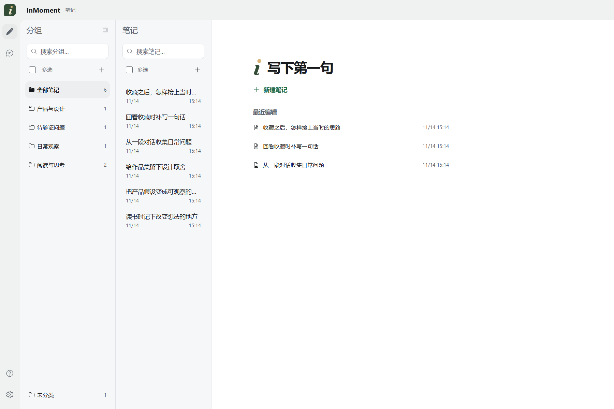
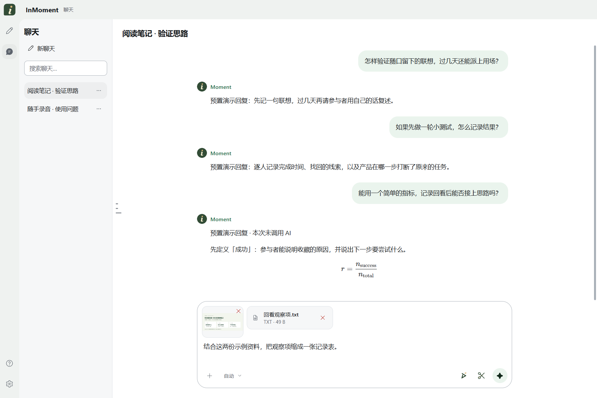
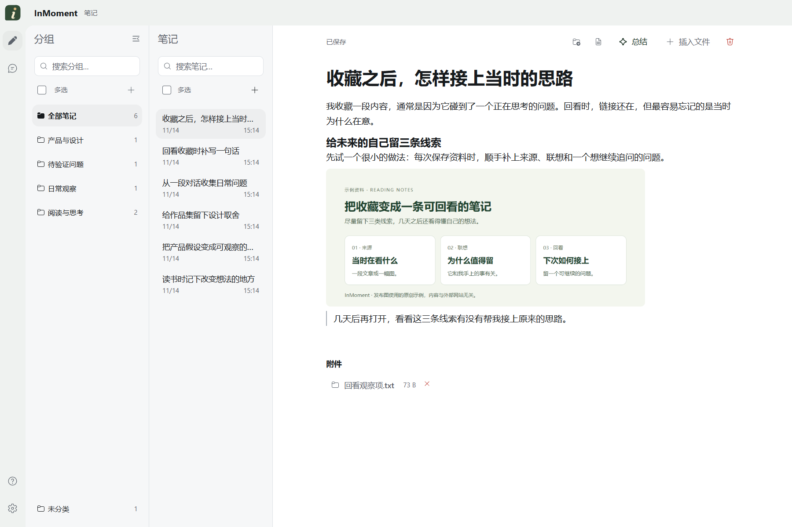
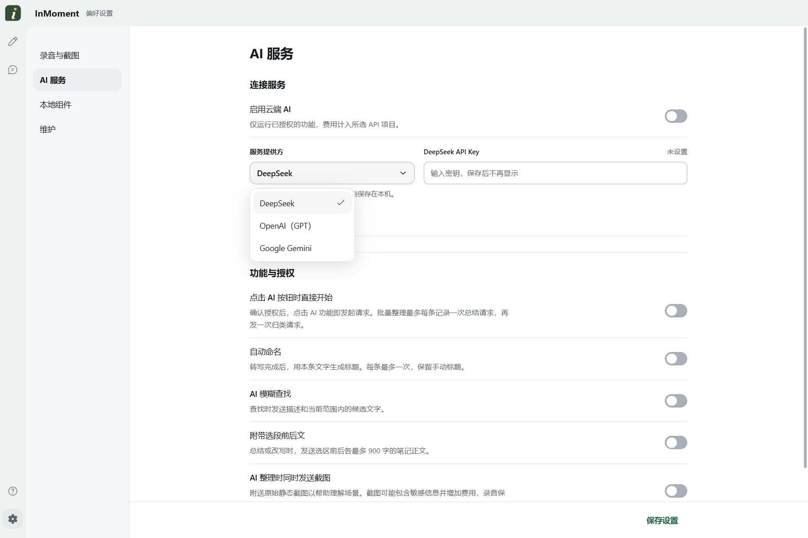

# InMoment 使用指南

适用于 **InMoment 0.14.31 · Windows 11 x64**。在「笔记」写下想法、保存录音及来源，也可以把笔记和附件带进 AI 聊天继续讨论。

本页截图为 0.14.31 实际界面，使用合成示例资料及预置 AI 内容，来源见[素材记录](assets/releases/v0.14.31/PROVENANCE.json)。

## 打开与更新

[下载 Windows 安装包](https://github.com/lenqi777/InMoment/releases/download/v0.14.31-installer/InMoment-Setup-0.14.31-x64.exe)，打开后按向导选择安装目录。缺少 VC++ x64 Runtime 时，向导会在征得同意后从微软下载。完成后从开始菜单打开 InMoment。安装包已附离线转写、语义检索和图片 OCR 组件，首次安装无需另装 Python 或下载模型。

关闭主窗口后，程序仍在托盘中。更新时先从托盘选择“退出”，再运行新版。已有设置、记录和附件会继续保留。正常资料位于 `%APPDATA%\InMoment`；退出应用后备份整个目录，API Key 受当前 Windows 用户保护，换电脑后应重新填写。历史版本试用请使用独立资料目录，避免降级修改新版资料，详见[版本清单](releases/VERSIONS.md)。

首次安装系统运行库需要联网，可能需要管理员授权。完成后，本地功能可离线使用。安装器未签名，Windows 可能要求确认发布者。安装器的 Windows 11 x64 虚拟机验收范围见[安装版 Release](https://github.com/lenqi777/InMoment/releases/tag/v0.14.31-installer)。

## 写笔记、管理分组与导出

- 「笔记」从左到右是分组、笔记列表和正文。启动时打开「全部笔记」，空白页可新建笔记或打开最近编辑的三条。分组列可以收起；展开后恢复之前的浏览位置。点分组更新原列表，点笔记打开正文；窄窗口用「返回笔记列表」回到原列表。
- 在组内新建的笔记自动归入当前组，首次输入标题、正文或添加附件时保存，后续修改自动保存。正文里可粘贴网址、图片和资源管理器中复制的文件，也可用「插入文件」。图片和可播放的视频在笔记内预览，普通文件可在资源管理器中查看。
- 双击正文图片或打开聊天里的大图，即可拖选图中文字并按 `Ctrl+C`。用「提取图片文字」查看整图结果，或用「框选提取」处理指定区域。当前完整便携版内置 RapidOCR 和 PP-OCRv6 small，识别在本机运行，图片留在电脑上。
- 整图或框选区域识别到思维导图结构时，结果默认显示「大纲」。框内文字保留换行，子分支按层级缩进。「复制全部」可粘贴到另一条笔记并保留标题和列表层级，也可以直接「插入到图片下方」。「纯文字」显示逐行识别结果。
- 右键分组可以建子分组、移动、复制、粘贴、改名或导出。删除分组并保留内容时，内容进入最近的父分组，顶层组的内容进入「未分类」。也可选择同时删除分组和内容。「我的分组」下可全选或开启多选，批量复制、合并与删除。
- 右键笔记可重命名、AI 整理、复制、删除、添加到组或导出。添加到组会在目标组生成独立副本。「未分类」位于分组树底部，可用 AI 分类查看建议并确认归组。
- 导出支持 PDF 和 Markdown。分组导出包含子分组里的笔记，可合在一个文档中，也可每条分别生成文件。原始附件、保留的录音和截图随文件另存，分享时可连同附件文件夹一起发送。

## 截图录音

- 按 `Ctrl+Shift+F9` 在鼠标所在屏幕打开框选工具。松手后用普通录音胶囊录音，同时可继续标注。拖动波形或计时区域可以移动截图录音浮窗，其他录音展开后也能这样拖动。截图录音用展开面板里的「问 AI」，上滑手势关闭。
- 点截图勾号把裁剪、画线和文字合成的图片加到草稿并复制到剪贴板，录音继续。暂停录音时仍可标注，按 Esc 只取消未确认的截图。保存笔记后可在「背景信息」查看截图。聊天截图确认后也会复制编辑完成的图片。
- 改快捷键时，在「偏好设置 → 录音与截图」点击当前快捷键，然后直接按下新组合键。松开主键后立即保存，按 Esc 可取消。组合键已被占用时，原快捷键继续有效。
- 暂停后默认离线转写，可在录音面板编辑笔记正文。「保留文字」和「保留录音」可同时勾选，至少保留一项。点击「存为笔记」后，选中的文字进入正文，选中的录音可在「背景信息」播放。转写不可用时可手动填写、重试或只保留录音。
- 旧录音记录和手写笔记都在「笔记」中，可直接改标题和正文。点「背景信息」查看保留的录音、截图、来源窗口与网址。
- 若上次退出时还有未完成的录音，最左栏会出现「恢复录音」，可以继续、存为笔记或删除草稿。

## 长按右键记录

1. 在正在看的网页或软件中按住鼠标右键，等待水平进度条填满。提前松开仍是普通右键。
2. 开始录音后说出想法，胶囊显示圆形 Logo、实际音量条和时长。松开右键会展开紧凑面板；点击播放图标可免按住继续说，再点击暂停图标或胶囊暂停这一段。
3. 暂停后可查看转写、编辑正文、选择分组和保存内容，最后点击「存为笔记」。没有选组的笔记进入「未分类」。暂时不想保存，可以丢弃草稿。

一次完成前的所有录音段都属于同一条灵感。

需要查看录音说明时，点击最左图标栏底部、设置上方的问号按钮。

开启来源截图后，长按录音会尝试保存当时活动窗口的一张截图。部分受保护或最小化窗口可能无法截图，可以在设置中排除不兼容的应用。

本地转写组件就绪后，保存的录音可以转成文字。没有组件时仍可录音、回听和手动补充内容。识别后的专有名词等细节可以对照原声修改。

## 随手问 AI

点击最左侧聊天图标进入欢迎页，可以直接输入问题，或从输入框左下角「＋」菜单添加附件、引用已有笔记一起讨论。发出第一条消息后，会话出现在聊天历史中；仅附加图片也可发送，Moment 默认解读图片。聊天里的语音和截图留在当前会话。点击图片缩略图可打开预览，按 Esc 关闭。回复流式显示，可随时停止或重试。从录音带入的背景可随消息发送，包括取得的来源应用、窗口标题和网址。

聊天支持行内和独立公式，代码示例保留原文；长公式可在公式区域横向滚动。向上阅读时，输入和新回复会保留阅读位置。点击左侧短线可跳到对应提问，正文滚动时当前短线随之更新。轮次较多时，把鼠标停在短线区域上下沿可翻看更多提问；用「回到底部」回到最新一轮。

「＋ → 添加文件或图片」可以把 PDF、UTF-8 TXT／Markdown、MP4 和图片放在同一条消息中。非图片附件每条最多 4 个、合计 12 MiB，每份文本最多处理 4 万字符。图片和文件都可在发送前单独移除。发送时使用当前服务的密钥，默认按问题自动选模型。也可以在输入区指定回答模型与推理强度；需要附件协助时，由同一家服务的模型读取材料，再把证据交给所选模型回答。

Gemini 可以收到原始 PDF 和 MP4。GPT 直接读取 PDF，DeepSeek 接收本机提取的 PDF 文字和抽样页图。GPT 和 DeepSeek 在本机处理最多 5 分钟的 MP4，发送抽样画面和本地语音转写；没有音轨时只提供画面。此路径需额外提供 `ffmpeg.exe` 和 `ffprobe.exe`：将两者放在 `InMoment.exe` 同级的 `chat-media/bin/` 中，或将其目录加入 PATH 后重启应用。Gemini 的原视频路径无需这两个工具。服务的单次请求上限还会计入图片和随轮次保留的附件。

主窗口可展开“查看处理过程”，查看实际执行的阶段与耗时。浮窗只显示当前阶段。笔记选段改写在原处显示等待状态与结果。

历史列标题下的「新聊天」可返回新的欢迎页。每条聊天右侧的更多菜单可重命名或删除；重命名在原行完成，勾号保存、叉号取消，名称不能只含空白。

在其他软件中长按右键录音时会显示白色胶囊；向上滚动鼠标滚轮可以暂停录音并展开聊天浮窗。松开右键或点击左侧圆形图标，会从同一个白色表面展开录音面板；此后点击同一位置的播放／暂停图标控制录音，也可以从面板点击“问 AI”。可选文字通过系统可访问接口读取，取不到时留空；图片中的文字可以通过来源截图提问。

从胶囊带入的首次转写作为灰色候选持续显示，按旁边提示的 Tab 键采用；键帽本身不属于输入文字。聊天里的录音按钮用于主动语音输入，录音时输入框、文字、附件和全部按钮都留在原位，波形显示在加号与录音之间，发送变灰等待录音及转写结束。再次点击品牌暂停图形后在本机转文字，直接加入可编辑正文；播放图形可以继续录入。普通 Tab 只采用候选或保留输入焦点，不选择其他组件。输入区随文字增高，浮窗达到屏幕可用高度后输入内容可上下滚动，发送按钮保持可见。没有输入与有效候选时显示“你有什么想法～”。确定静音或成功转写只有标点／空白时，按临时录音规则清理本次空片段；转写失败保留录音供重试，已有文字和有效片段继续保留。

录音与发送之间的截图按钮会暂时隐藏聊天，截取鼠标所在的屏幕并进入框选标注。把鼠标停留在按钮上 1 秒，可以勾选“不隐藏当前页面”，应用会记住这个选择。选好范围后可以画笔涂写、添加矩形／椭圆／箭头和文字、选择颜色，并撤销或重做。点击勾号将原图选区与标注合成一张图片加入聊天附件，等待你发送；点击叉号或按 Esc 取消，聊天和已有输入会恢复。整个截图编辑过程在本机完成。

截图按钮现在用剪刀图形，每次移入会剪一下，停留后出现紧凑的选项胶囊。鼠标从按钮移到胶囊有 1 秒宽限；只要停留在按钮或胶囊上，选项就保持可用，离开双方区域 1 秒后收起。主动录音期间，左下加号原位变成取消叉号，可直接取消这次录音并保留原有文字和附件。

软件内创建的聊天默认自动保存，首次发送后进入历史。小浮窗发起的聊天默认临时，可点击顶部勾号保存；关闭有内容的未保存浮窗时，可选择保存并关闭、不保存并关闭或继续聊天。转到主窗口会先保存聊天。语音输入只保存进入聊天的文字，想保留原始录音可用录音面板存为笔记。右键消息或选中文字可以引用或多选，选中后从底部存为笔记；加号菜单也可保存整段聊天。浮窗意外隐藏或最小化后，再次长按或点击主窗口「返回聊天」可回到同一会话；隐藏或失焦会暂停主动录音。

引用文字会清理多余的格式符和空白，以独立卡片显示在图片旁，点对应叉号即可移除，输入的问题保持不变。系统或其他软件复制的截图可直接粘贴进聊天，作为图片附件等待发送。多选后点击「存为笔记」直接保存原文；在该按钮上停留 1 秒，上方会出现「AI 总结」，点击后将选中的对话总结再保存。

在加号菜单选择「引用笔记」后，发送消息时会把笔记正文和图片一起交给当前 AI 服务。正文图片按阅读顺序发送，图片附件排在正文图片之后。聊天保存本次发送的图文副本，后续追问或重试仍可使用。

每次可直接添加最多 4 张图片。直接添加的图片和笔记图片单张最多 8 MiB，每条消息合计最多 24 MiB。聊天上下文最多包含 20 张图片。引用文字最多 8 段，单段最多 10000 字、合计最多 40000 字。聊天快照最多 48 MiB，超限时保留当前内容并提示，可以减少附件或开始新聊天。

浮窗草稿明确保存后，即使还没有发送消息，也能在正式聊天历史中找回；未采用的转写仍作为候选显示。点击“新聊天”会保留这些已保存草稿。

## 回看来源与批量管理

点笔记顶部的「背景信息」查看保存的录音、来源及截图；仅显示有内容的区块。可在这里回听录音、打开来源网址，或点击截图放大浏览。笔记正文已保留文字时，可在背景信息中单独移除录音，正文、截图和其他附件继续保留。

用笔记列的搜索框查找标题和正文，`Ctrl+K` 可直接聚焦。点击「多选」再勾选笔记，或点击左侧总选框选择当前范围；选中后用更多菜单执行批量操作，点击「完成」退出。删除前可检查所选范围并取消。

## AI 总结与一键整理

在「偏好设置 → AI 服务」中选择 DeepSeek、OpenAI（GPT）或 Google Gemini，填写自己的 API Key，再点击「保存设置」。模型默认自动选择，需要指定时展开手动模型设置。云端功能默认关闭，使用前选择需要的功能并确认授权。

三个服务分别保存模型与加密密钥。切换设置页的下拉选项只改变当前表单，保存后才生效；AI 总结、一键整理、按描述查找和自动命名都会使用当前已保存的服务。保存、切换和重新打开软件都不会自动测试 API。获取密钥、模型预设与切换说明见 [AI 服务设置](AI_PROVIDER_SETUP.md)。

更换服务时，如果还有已启用的 AI 功能，程序会再次说明数据发送到哪里并请你确认。取消保存则继续使用原来的配置。保存新的服务、当前模型或当前密钥后，会取消尚在运行的旧配置任务并清理相关查找缓存，已保存的记录和摘要保留。

**AI 总结全文**在笔记顶部的四角星按钮。点击后会使用标题、正文和来源背景生成一份独立的总结笔记，挂到原笔记的附件区。打开附件可以编辑总结，原笔记正文保留。

选中正文后，右键或按 `Shift+F10` 打开「总结」「改写」。淡绿色胶囊出现在选区旁，保留原文高亮。总结可以直接复制。改写时输入要求并发送，可拖动结果浮层的标题，预览高亮即将替换的文字。对列表输入「再补充几条」时，点勾会把预览中的新条目加到该列表末尾。普通改写点勾只替换原选区。两种操作均可用 `Ctrl+Z` 撤销，点叉放弃预览。附件右上角的小叉号可直接移除该附件。

**整理与分类**会按所选笔记给出分组建议。未分类笔记可用「AI 分类」，单条笔记也可通过右键菜单「AI 整理」。预览时可以调整或取消单条建议，确认后才写入分组。

云端 AI 启用后，点击全文或选段总结会直接请求当前服务，改写在提交方向时发送。全文总结的截图需要另外开启“AI 整理时同时发送截图”。一键整理沿用“点击 AI 按钮时直接开始”设置。已发送的请求可能产生费用。

在「偏好设置 → AI 服务」开启并确认「附带选段前后文」，选段总结和改写会把选区前后各最多 900 字的相邻正文一起发给当前 AI 服务。此项默认关闭。

截图辅助理解还需要所选模型支持图片输入。需要附图但模型未被当前版本识别为支持图片时，程序会提示并停止该次整理；可以改用支持图片的模型，或自行关闭截图开关后重新开始。

自动命名有独立开关，开启后会在记录完成且转写成功时生成短标题，保留你手工修改的名称。

旧版 DeepSeek 设置会继续保留。“恢复全部设置默认”会回到默认服务与模型、关闭 AI 功能，并保留三个服务已保存的密钥和全部灵感记录。

## 找回记录

笔记列表的关键词查找在本机完成。可先选择分组缩小范围，再输入标题或正文里的词。点击分组列的折叠箭头可为正文腾出空间，重新展开仍保留当前分组。

本版完整包已附本地语义模型，可在「偏好设置 → 本地组件」查看状态。旧版或开发包缺少组件时，可从设置显式安装；关键词搜索不依赖模型。

## 用示例体验

[23 条模拟灵感手册](manual-test-scenarios.html)准备了场景、网址和可以直接朗读的文案，方便手动录入、测试操作。

数据保存和发送方式见[隐私说明](../PRIVACY.md)，开发与测试方式见[开发指南](DEVELOPMENT.md)。
