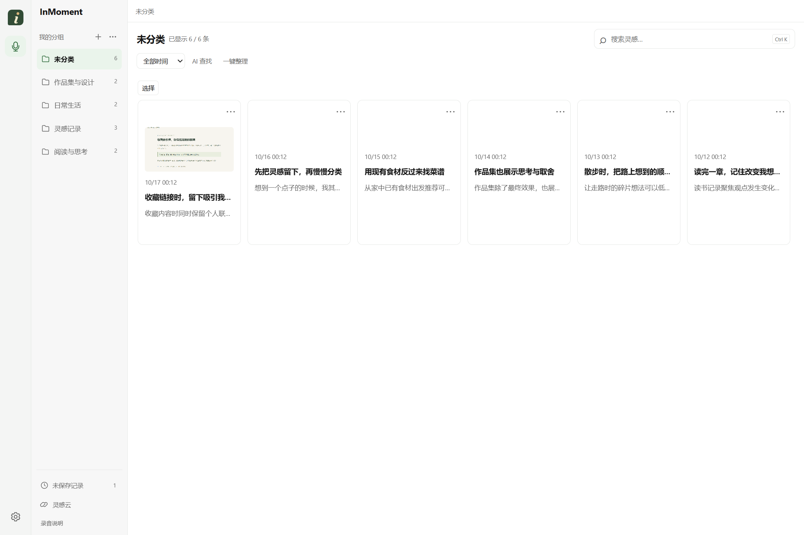
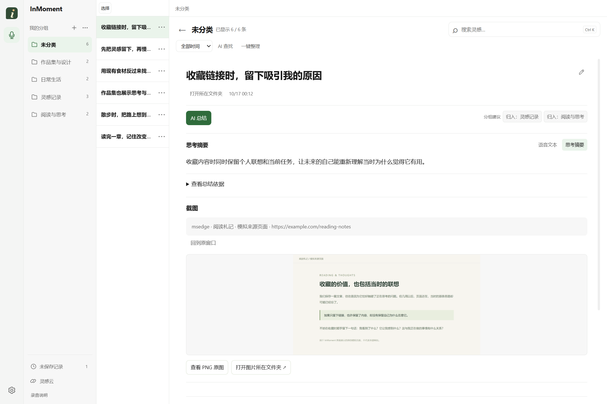
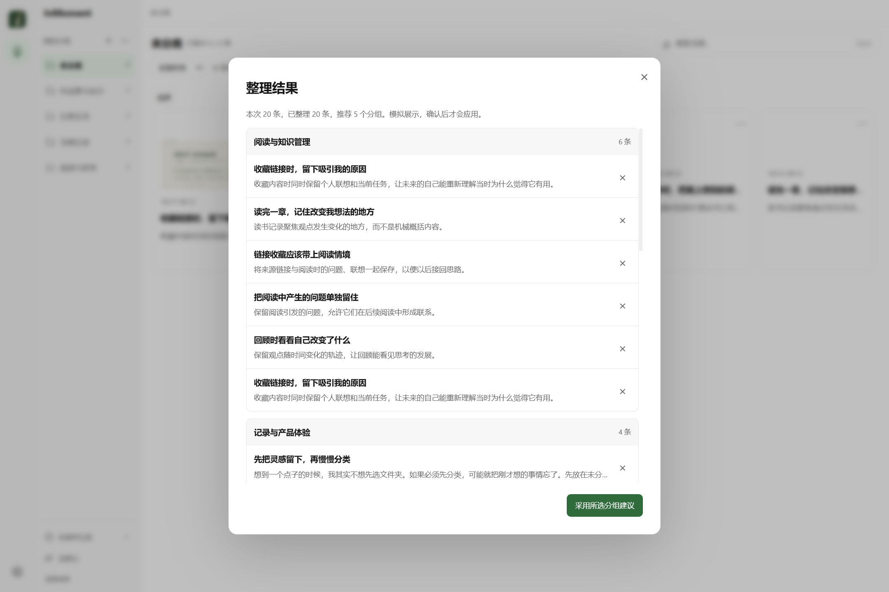

# InMoment：把灵感和它发生时的情境一起留下

我经常在浏览网页、看作品或整理资料时冒出一些想法。收藏链接很方便，但过几天再打开，往往只记得“这个东西不错”，想不起来当时为什么觉得它有用。如果立刻切换到笔记软件，把想法打下来、起标题、分好类，又很容易打断正在做的事。

我想做一个更顺手的记录工具：想法出现时先说出来，把声音和眼前的内容一起留下，等有空再整理。InMoment 就是从这个自用场景开始的。

目前它是一个已接入 AI 的 Windows 桌面原型，包含录音、转写、截图、AI 总结、分组、描述搜索和灵感云。我负责需求、使用流程、界面交互和验收，借助 AI 编程工具完成实现与测试。

## 先把记录这件事做顺

我把使用过程分成了三个阶段：记录、整理、找回。

记录时尽量少做选择。首次长按右键开始录音，松开暂停；想继续说，可以点击“继续录音”，不用一直按住。几段录音属于同一份草稿，最后再决定保存还是丢弃。没有选择分组的内容统一进入“未分类”。

这里最早确定的一点是：**分类可以晚一点，想法要先留下。** 如果为了以后好管理，反而要求每次记录前先选组、填信息，就偏离了这个工具的出发点。

来源窗口信息和单次截图用来补充当时的情境。比如我在看一张海报时想到一个排版方案，回顾时除了听到自己的话，还能看到触发想法的画面。截图获取失败时会提示，录音和记录仍保留。

## 回顾时，先让我看清自己的想法

我希望打开应用后能直接开始阅读，而不是先理解一套复杂的管理界面。现在最左侧是录音和设置，第二栏是分组。进入一个分组先看到卡片，打开一条记录后，卡片切换为标题列表，右侧显示正文。

分组栏和记录列表同宽，详情占主要空间。我希望前面的导航保持紧凑，让正文有足够的宽度。列表以前堆满了日期、状态和概述，很难快速扫到标题。最后我把记录列表简化成一行标题，把空间留给正在阅读的内容。

详情按标题、语音文本、截图、原始录音排列。标题可以修改，文件入口保留“打开所在文件夹”。AI 总结后，摘要显示在原来的文字区域，可以随时切回语音文本，原声和原文继续保留。

## AI 整理要帮我减轻负担

单条记录已经接入 DeepSeek 总结和分组建议。批量整理处理当前页面显示的内容：选中了某个分组或时间范围，就按这个范围整理。点击时会固定本批记录，后续切换页面不会把其他内容加进来。

分类的设计改过几次。

一开始，我希望 AI 优先使用已有分组，减少重复名称。但如果只强调这一点，一个很宽泛的组就可能吸收太多内容。后来允许 AI 推荐新组，又发现逐条判断容易把分类做得太细，几乎每条灵感都有自己的组。

所以现在把这件事拆成两步：先总结每条记录，再把本批摘要放在一起比较，找出共同主题。同义的名称尽量合并，没有共同主题的内容可以暂时不分组。结果按“这个组里有哪些灵感”展示，方便我从整体上看分类是否合适。

预览里可以取消某条建议，也可以换一个组，确认后再应用。分组建议采用后，当前记录继续留在原处，等离开后再更新列表，避免一次小操作打断阅读。

## 找回时，可以只记得一个大概

有时我记不起标题，只记得“上个月想过一个和做菜有关的点子”。所以除了关键词搜索，我加入了描述搜索，并让描述中明确提到的时间优先作为搜索范围。

实现上，先在本机用语义向量和关键词找候选，再交给云端模型排序。这样可以复用已有索引，也不用每次把所有记录逐篇发送。结果附上匹配理由和对应原话，便于判断是否找对。

灵感云是另一种浏览方式：每个点是一条记录，相似的内容连接成团。它适合在没有明确查询时看看哪些想法可能有关联。打开一条旧记录后，还可以“接着想”，录下新的内容，两条记录保持关联。

## 几次影响比较大的体验调整

| 当时遇到的问题 | 我的判断和调整 |
| --- | --- |
| 删除记录要进入详情，再滚到最下面 | 列表支持左滑操作，卡片使用菜单；删除确认放在就地小浮框里，并支持多选删除 |
| 创建主题和分析入口分散，操作前要来回切页 | 分组管理放到分组区域；整理按钮跟随当前内容范围 |
| 分组管理每一行都有合并下拉框 | 改为先选择多个组，再统一合并或删除；删除分组保留其中的记录 |
| 记录多起来后，标题和整理结果被压缩 | 用多条记录、多个分组和不同窗口尺寸检查实际显示，调整滚动区域与布局 |
| 自动命名、转写完成等后台信息一直占着页面 | 移除这些常驻提示，保留录音状态、错误和需要确认的操作 |
| 采用分组建议后突然跳到另一个组 | 保持当前阅读位置，离开后再刷新归属 |

这些调整逐渐把产品重点收回到“留下、读懂、找回”这条路径上。每个版本具体改了什么，可以在 [更新记录](../../CHANGELOG.md) 里查看。

## 本地和云端怎么分工

语音转写和语义索引放在本机，云端模型负责总结、归类和搜索候选排序。原始音频留在本地；截图是否参与 AI 总结，在设置中单独授权。密钥通过 Windows DPAPI 保存。

这个选择照顾了记录内容的私密性，也带来了安装包体积和本机资源占用。描述搜索只发送有限候选，减少上下文和费用，但本地没有召回的内容，后续排序也找不回来。我会把这部分作为下一步评测的重点。具体流程见 [AI 方案与评测计划](AI_DESIGN_AND_EVALUATION.md)。

## 目前做到哪里，接下来做什么

当前已经有可运行的 Windows 版本。v0.10 的验证记录包含 378 项测试通过、1 项桌面输入测试默认跳过；AI 流程使用模拟响应，界面检查使用合成记录，并覆盖了多记录、多分组和不同窗口大小。

接下来，我想先用一套固定样本检查摘要是否保留原意、分类是否方便回顾、描述搜索能否找回目标记录，再邀请有类似记录习惯的人完成几次真实任务。比较的对象会是他们原来的记录方式，重点看记录是否顺手，以及之后能不能找到。

目前尚未开展正式外部用户研究、真实搜索召回评测和记录流程的节省时长统计。
