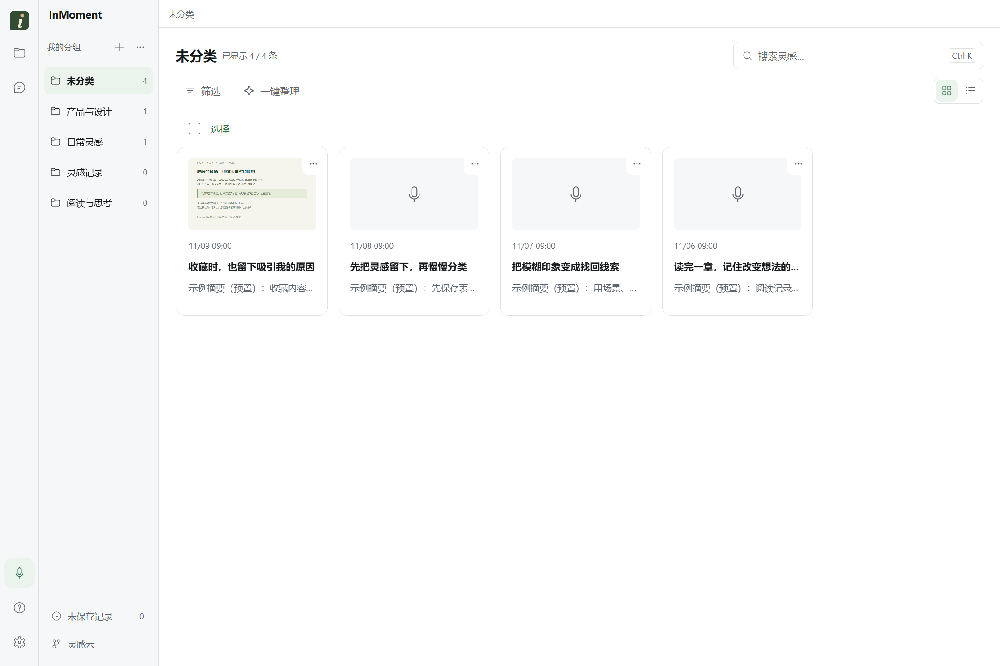
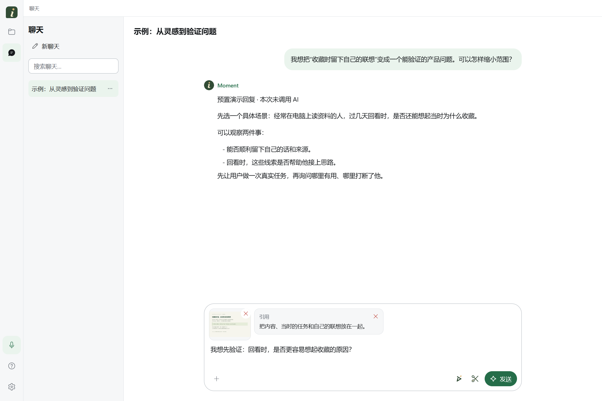

# InMoment 0.14.16

Windows 11 x64 · 本地待确认发布版本 · 2026-11-09

InMoment 把随口说出的想法和当时的情境一起留下：首次长按右键录音、松开暂停，之后点击继续即可免按住表达。原声、文字与来源可以一同回顾，也可以带进 AI 聊天，继续讨论后再保存为灵感。

## 本版重点

- **聊天成为可回顾的资料。** 主窗口聊天首次发送后自动进入历史，支持重命名、删除和重开。浮窗聊天保留临时状态，关闭前可保存、不保存或继续，转到主窗口时先保存。
- **引用和图片有独立位置。** 引用文字清理格式与多余空白后显示为可移除的附件卡片；支持粘贴剪贴板图片。输入内容、引用和图片可以分别调整，附件等待主动发送。
- **对话可以存回灵感库。** 多选消息后可直接保存原文；在“存为灵感”上停留一秒，会出现“AI 总结”，可整理所选对话后保存。
- **截图可以先框选和标注。** 聊天截图支持画笔、矩形、椭圆、箭头、文字及撤销／重做；确认后加入附件，不自动发送。编辑窗口完整覆盖所选显示器，修正底部任务栏重复显示。
- **回顾与记录更顺手。** 分组主页可切换卡片／列表，录音回放显示真实波形并支持定位；录音、暂停和继续保留同一份草稿。
- **云端服务按需选择。** DeepSeek、OpenAI（GPT）和 Gemini 分别保存密钥和模型配置，聊天、总结、分组建议、按描述查找及自动命名使用当前保存的服务。

同时修复已保存但未发送的草稿无法从历史找回、旧任务迟到干扰新浮窗、关闭与转写竞争、快速菜单关闭以及高缩放下输入和候选内容遮挡等问题。详细迭代见[更新记录](../../CHANGELOG.md)。

## 下载与首次使用

选择 **`InMoment-0.14.16-win-x64-full.zip`**，完整解压到普通本地目录后，首次运行 `Install-InMoment.cmd`，完成检查后打开 `InMoment.exe`。

完整包已附程序运行时、离线语音转写和本地语义模型，普通用户无需安装 Node.js、pnpm、Python 或自行下载模型。若设备缺少 VC++ x64 Runtime，安装入口会先询问，再下载并打开微软原厂安装向导。程序目前未代码签名。

本地记录、回听、转写、手动管理、关键词搜索和灵感云无需 API Key。云端 AI 默认关闭；在设置中选择服务、填写自己的 Key 并授权后使用，费用由自己的 API 账户承担。截图用于 AI 整理需另行授权，原始录音不随这些 AI 功能上传。

GitHub 自动生成的 **Source code** 附件供开发使用。最终完整包大小、SHA-256 和检查结果随本轮交接包提供。

## 从旧版更新

先从托盘退出 InMoment，再将新包解压到新的目录，按安装入口检查后运行。设置、记录与附件保存在 `%APPDATA%\InMoment`；升级前退出程序并备份整个资料目录。更换电脑后重新填写 API Key。

旧版本保留为独立资产。试用旧版时使用独立资料目录，避免降级写入新版资料；不要让多个版本同时写入同一资料库。

## 截图与检查

截图来自实际 0.14.16 界面，使用合成示例资料和预置 AI 内容。验证覆盖与来源见[素材记录](../assets/releases/v0.14.16/PROVENANCE.json)、[验证记录](../validation.md)与[发布状态](READINESS.md)。全新 Windows 安装及真实模型／云端效果仍待验收。
