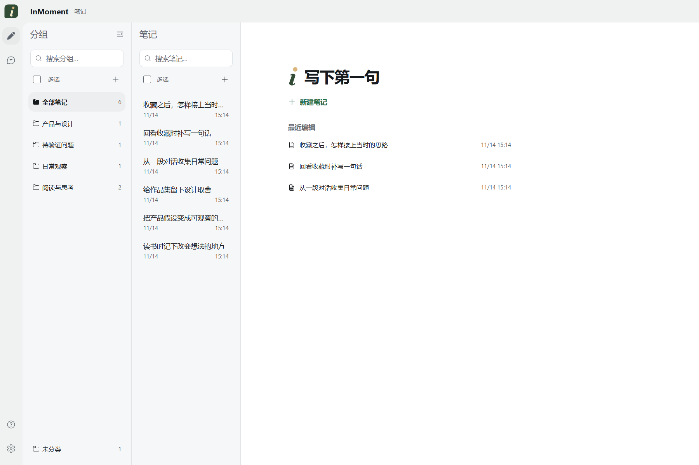
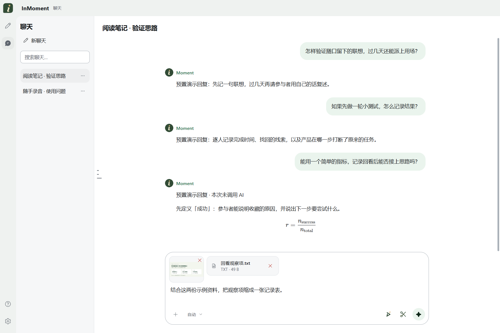

# InMoment 0.14.31

Windows 11 x64 · [GitHub 下载与 SHA-256](https://github.com/lenqi777/InMoment/releases)

InMoment 把随口说出的想法和当时的截图、录音与来源保存在可编辑笔记中。笔记可按组整理、搜索、导出，也可带进聊天继续讨论。

## 本版重点

- **一处打开全部笔记。** 启动进入「全部笔记」。分组、列表与正文同屏，窄窗口可返回列表。空白页提供新建笔记和最近编辑入口；展开分组列后继续之前的浏览。
- **从截图开始记录。** 按 `Ctrl+Shift+F9` 并框选，松手即开始录音，之后可继续标注。长按右键的首次录音、松开暂停及点击继续的流程保持；多段录音同属一份草稿。存为笔记时可选文字、录音或两者，通过「背景信息」回看来源。
- **在本机提取图片文字。** 在笔记或聊天查看大图，可提取整图或框选区域并复制结果；笔记内还可把结果插入图片下方。支持思维导图大纲预览，识别使用内置的 RapidOCR 与 PP-OCRv6 small。
- **把笔记和附件一起分享。** 笔记、分组可导出 PDF 或 Markdown，包含子分组时可合并为一个文档或逐条导出。录音、截图和原始附件可一并另存。
- **一轮聊天讨论多份材料。** PDF、UTF-8 文本、MP4 与图片可加入同一条消息，主窗口显示处理阶段和耗时。支持本地公式排版、侧边短线跳转与阅读位置同步。选中的对话可直接存为笔记，也可先用 AI 总结。
- **自主选择云端服务。** DeepSeek、OpenAI（GPT）与 Gemini 独立保存设置。聊天可自动或手动选择回答模型与推理强度。笔记全文总结另存为附件；选段改写先预览，确认后才更新原文。
- **笔记、聊天和设置统一外壳。** 顶部标题栏和左侧导航与内容区衔接，悬停、按下和选中使用统一的浅底反馈；当前聊天的标题与更多入口共用一块底色。

各预览版的细节见 [更新记录](../../CHANGELOG.md)。上一轮 [0.14.16 发布说明](0.14.16.md)作为历史保留。

## 下载与首次使用

在 [GitHub Releases](https://github.com/lenqi777/InMoment/releases) 查看本版完整包 `InMoment-0.14.31-win-x64-full.zip` 的发布状态。下载后完整解压到本地目录，首次运行 `Install-InMoment.cmd` 检查系统运行库，完成后打开 `InMoment.exe`。

完整包随附运行时、离线语音转写、语义模型和图片 OCR。普通使用无需另装 Node.js、pnpm 或 Python。缺少 VC++ x64 Runtime 时，安装入口会请求同意，再下载并打开微软原厂安装向导。完整包附 SHA-256 校验文件，GitHub 自动生成的 **Source code** 附件供开发使用。

本地功能无需 API Key。云端 AI 默认关闭，启用时请选服务、填写自己的 Key 并查看发送范围和费用。Gemini 可接收原始 PDF 和 MP4，GPT 可接收原始 PDF，DeepSeek 接收本机提取的 PDF 文字及抽样页图。GPT 或 DeepSeek 分析 MP4 时，需要另配 `ffmpeg.exe` 和 `ffprobe.exe`，放入同程序目录的 `chat-media/bin/` 或加入 PATH。Gemini 原视频路径无需这两个工具。

## 从旧版更新

先从托盘退出 InMoment，并备份 `%APPDATA%\InMoment`，再把新版解压到新的目录运行。该目录保存本机账户的设置、笔记和附件；换电脑后重新填入 API Key。旧版本保存在独立归档中，试用时使用独立资料目录，避免不同版本同时写入同一份资料。

## 截图与检查

截图取自 0.14.31 实际界面，使用合成资料与预置 AI 内容，见[素材记录](../assets/releases/v0.14.31/PROVENANCE.json)。运行条件和验证范围见[发布状态](READINESS.md)；具体操作见[使用指南](../USER_GUIDE.md)。
